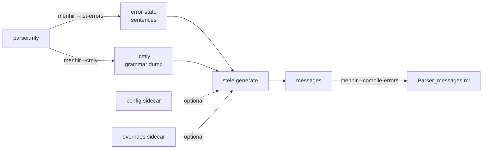

# stele

Machine-generated, user-friendly syntax-error messages for any
[Menhir](https://gitlab.inria.fr/fpottier/menhir) grammar.

A Menhir parser that meets bad input raises `Error`, which carries no
explanation: the driver can say where the parse failed, but not what was
expected there. Menhir can show a real message instead, but only if you write
one for every point where the parse can get stuck. A realistic grammar has
hundreds of them, and each needs revisiting whenever the grammar changes.

stele writes those messages for you. It reads the grammar, works out what each
failure point would have accepted next, and says so in plain terms:

```
Error: Expecting ')' or an operator.
 --> unclosed.calc:1:6
1 | { (1 }
  ·      ^
  ·   ^ This '(' opens the enclosing construct.
```

Because the messages are generated, you can pin them in golden files. A
grammar change then shows up as a diff of the messages for you to review,
instead of leaving hand-written messages to go stale.

stele powers the error messages of both grammars in the
[Wax](https://github.com/ocsigen/wax) toolchain (WebAssembly text and the Wax
language). It builds on François Pottier's work on error diagnosis in LR(1)
parsers; see [Credit](#credit).

The [tutorial](TUTORIAL.md) is the place to start. It takes a tiny calculator
grammar from the bare "Syntax error" to the full setup in ten stages, and
follows the same three errors through each one. Its final state is the runnable
example in `example/`.

> The message templates are English-only, and the heuristics have so far been
> tried on two grammars, so expect rough edges.

**Contents**

- Getting started: [Install](#install), [Quick start](#quick-start),
  [Key terms](#key-terms), [What a message contains](#what-a-message-contains)
- Setting it up properly: [The pipeline](#the-pipeline-dune-rules),
  [The command line](#the-command-line), [Golden files](#golden-files)
- Improving the wording: [The config file](#the-config-file),
  [Naming](#naming), [Merged states](#merged-states),
  [The overrides file](#the-overrides-file)
- Advanced: [The runtime helper](#the-runtime-helper),
  [The annotation tuner](#the-annotation-tuner)
- Reference: [Troubleshooting](#troubleshooting), [Layout](#layout),
  [Credit](#credit)

## Install

stele is a standard dune/opam project. You need OCaml (`>= 4.14`) and menhir.

```
opam install stele
```

You get two things:

- the `stele` executable, which generates the messages at build time;
- the `stele.runtime` library, a small helper your parser links.

menhir is needed only at build time. At run time your parser uses just
`stele.runtime`, which depends only on `menhirLib` and the standard library, so
it also builds under `js_of_ocaml` and `wasm_of_ocaml`.

## Quick start

The smallest useful setup needs no config and no golden files. Next to your
`parser.mly`, add four dune rules:

```lisp
; 1. list the error states, with a sample input for each
(rule (with-stdout-to msgs.auto
        (run menhir %{dep:parser.mly} --list-errors)))

; 2. dump the grammar in machine-readable form
(rule (target parser.cmly) (deps parser.mly)
      (action (run menhir %{dep:parser.mly} --cmly --no-code-generation --base parser)))

; 3. stele turns those two into one message per state ...
(rule (with-stdout-to msgs.full
        (run stele generate --cmly %{dep:parser.cmly} %{dep:msgs.auto})))

; 4. ... which menhir compiles into a module your parser queries
(rule (with-stdout-to parser_messages.ml
        (run menhir %{dep:parser.mly} --compile-errors %{dep:msgs.full})))
```

You now have `Parser_messages.message : int -> string`, which maps each error
state to a message. Call it from your parser's error handler.

That is enough to get a message for every error state. From there, you can
alias your tokens, improve the wording with a config file, pin golden files,
and fill in the location markers at run time. The [tutorial](TUTORIAL.md) adds
these one at a time, and [The pipeline](#the-pipeline-dune-rules) shows the
full set of rules.

## Key terms

You do not need parsing theory to use stele, but a few terms come up often.

- **Error state.** As a parser reads input, it moves through internal states.
  An *error state* is one where the next token cannot be accepted, so each error
  state is one specific way a parse can fail.
- **`--list-errors` and `--compile-errors`.** The first Menhir command lists
  every error state, each with a sample input (a *sentence*) that reaches it.
  The second takes one message per state and compiles them into an OCaml module,
  `Parser_messages`, that your parser queries by state number. stele is the step
  in between: it writes the messages.
- **`.cmly`.** A machine-readable dump of the grammar (`menhir --cmly`). stele
  reads it so its messages follow the real rules.
- **Expecting list.** For one error state, what the parser would have accepted
  next.
- **Golden file.** A committed copy of expected output. A test compares fresh
  output against it, and `dune promote` updates it after you have reviewed the
  change.
- **Sidecar.** A small file kept beside the grammar that gives stele
  grammar-specific information. There are two, both optional: the config file
  and the overrides file.

## What a message contains

For each error state, stele produces some of the following.

- An Expecting list of what could legally come next, worked out from the
  grammar: "Expecting ')' or an operator." It is capped at five items; a
  state with more falls back to "Syntax error", unless a `[class]` in the
  [config file](#the-config-file) shortens the list or you write an override.
- A **delimiter hint** pointing back at the `(`, `[` or `{` the parser is still
  inside: `<2>This '{' opens the enclosing construct.` The `<2>` is a
  placeholder that the [runtime helper](#the-runtime-helper) replaces with the
  real source location.
- A **hedge**, when the parser has fully read a construct before failing.
  Rather than list everything the construct could still contain, the message
  assumes it is finished: "Assuming that the statements are complete, expecting
  '}'." A **subject marker** such as `<^1>these statements` lets the runtime
  helper underline that construct. Hedges come from `%on_error_reduce`
  annotations in the grammar (see [Naming](#naming)).
- A **hand-written override**, for the few states the heuristics cannot handle
  well (see [The overrides file](#the-overrides-file)).

stele works out each Expecting list from the grammar rather than reading it off
the parser's tables, so it checks the result against the compiled parser:

- a **soundness check** confirms that every token a message calls legal has an
  action in that state (`listed tokens the parser rejects` in `stats`);
- a **state-correspondence check** confirms that the `.messages` file and the
  `.cmly` number the states the same way (`states numbered as in the .cmly`
  in `stats`). stele combines its two inputs by state number, so if this check
  fails, every message is suspect.

## The pipeline (dune rules)

The generator runs at build time, in four steps: menhir lists the error states,
menhir dumps the grammar, stele writes the messages, and menhir compiles them
into the module your parser calls. The two sidecars are optional.



The full set of rules adds the sidecars and a golden check.
[`example/dune`](example/dune) has a complete, runnable copy.

```lisp
; 1. one sample sentence per error state
(rule (with-stdout-to g.auto.messages
        (run menhir %{dep:parser.mly} --list-errors)))

; 2. the exact grammar (--no-code-generation keeps --cmly from running the
;    code back-end, which would need dune's type inference)
(rule (target g.cmly) (deps parser.mly)
      (action (run menhir %{dep:parser.mly} --cmly --no-code-generation --base g)))

; 3. the messages without comments, sorted, checked against a golden file
(rule (with-stdout-to g.actual
        (run stele generate
             --no-comments --cmly %{dep:g.cmly} --config %{dep:parser_messages.config}
             --overrides %{dep:parser_messages.overrides} %{dep:g.auto.messages})))
(rule (alias runtest) (action (diff parser_messages.expected g.actual)))

; 4. the full messages (with comments), compiled into a Parser_messages module
(rule (with-stdout-to g.messages
        (run stele generate
             --cmly %{dep:g.cmly} --config %{dep:parser_messages.config}
             --overrides %{dep:parser_messages.overrides} %{dep:g.auto.messages})))
(rule (with-stdout-to parser_messages.ml
        (run menhir %{dep:parser.mly} --compile-errors %{dep:g.messages})))
```

## The command line

stele has one subcommand per kind of output. They all take the same inputs:

```
stele <command> --cmly g.cmly [--config g.config] [--overrides g.overrides] g.messages
```

`--cmly` is required; the two sidecars are optional. `stele --help` and
`stele <command> --help` print the manual pages.

| Command | Prints | Use it when |
|---|---|---|
| `generate` | the messages (`--no-comments` for the golden version) | always: this is the build step |
| `stats` | quality counters and self-checks | you want a quick health check, or to judge whether a golden diff is a regression |
| `census` | each distinct message once, with a count | you are reviewing a wording change across many states |
| `names` | how every symbol is turned into words, and why | a symbol reads wrong and you want to know which rule produced it |
| `fallbacks` | a ready-to-paste override for each state that says only "Syntax error" | you want to hand-write those messages |
| `suggest-classes` | candidate `[class]` blocks that would shorten long lists | an Expecting list is too long and some tokens always appear together |
| `transitions` | every possible continuation per state, with annotations | you are debugging the generator itself |

`stele tune` is different: it runs menhir itself, once per trial, starting from
the grammar source. See [The annotation tuner](#the-annotation-tuner).

Wire each command as a dune alias per grammar, with the file paths written
once and a `(universe)` dependency so it re-runs on request. This saves typing,
and a hand-run command can no longer leave out `--overrides` by mistake. The
inspection commands are fast. The `tune` commands re-run menhir many times and
take tens of seconds, so keep them out of `runtest`.

### What `stats` reports

`stats` prints counts of: error states, those with an Expecting list or an
"Assuming" hedge, those left with a bare "Syntax error" (with nothing to list,
or more than five items) that no override covers, delimiter hints and missed
ones, names shown as jargon, how many constructs a hedge assumes at most, and
the results of the checks against the parser's tables.

It ends with one line per configured class, in file order:

```
class "an operator": applies in 3 states
```

The number is how many states had two or more of the class's members legal at
once, so the class applied. It counts these states even when an override or the
five-item cap keeps the label from being shown. Zero is allowed (a class
can wait for a state that needs it), but if you pin the `stats` output in a
[golden file](#golden-files), a class that stops applying after a grammar change
shows up as a diff.

It also reports `names configured: X, unused: Y`, with a line for each
`[names]` entry that nothing uses.

### What `census` reports

`census` prints each distinct message once, with how often it occurs. The
stack index in delimiter hints is written `<_>`, so if menhir picks a different
sample sentence for a state, at most a count changes. If you pin the `census`
output in a [golden file](#golden-files), a wording change is a one-line diff.

### What `names` reports

A table of every symbol that appears in a message, showing:

- how it is rendered;
- which [naming](#naming) rule produced it: `token alias`, `[names]`,
  `element` (of a list or option), `plural of element` (a list as a hedge
  subject), `rule name`, `[class]`, or `token name`;
- how often it appears in the Expecting list and as a hedge subject.

The two positions are counted separately because a symbol can read differently
in each. For example, a list is named by its element in the Expecting list ("a
parameter") but keeps its plural as a subject ("the parameters"). After the
table come any `[names]` entries used in neither position.

Use it to find two things: awkward renderings that deserve a `[names]` entry
(especially a token name shown in quotes as if the user should type it), and
`[names]` entries that nothing uses.

### What `suggest-classes` reports

`suggest-classes` prints candidate `[class]` blocks for the config file. It
groups tokens that are always legal in the same states, so merging them under
one label never hides a token a state needed. It keeps groups of three or more
and ranks them by how many lists they would bring under the five-item cap:

```
# 5 tokens always accepted together, in 6 states. One label for them
# brings 4 Expecting lists under the five-item limit and removes 24 items.
[class <LABEL>]
BLOCK
IF
LOOP
TRY
TRY_TABLE
```

You choose the label. Sometimes you also split a group: arithmetic and
comparison operators, for instance, are often legal in the same places and
land in one group, but read better as two labels.

## Golden files

Pin three views of the output, each as its own golden file:

| Golden file | Command | What it pins |
|---|---|---|
| `parser_messages.expected` | `stele generate --no-comments` | each sample sentence and its message, sorted by sentence so renumbered states cause no churn |
| `parser_messages.stats.expected` | `stele stats` | the quality counters, so a drop in quality shows up as a diff |
| `parser_messages.census.expected` | `stele census` | the distinct messages with counts, a compact view of all the wording |

After any grammar or generator change, run `dune runtest`, read the three
diffs, then run `dune promote`. A message diff you agree with is fine. A `stats`
counter that gets worse, with no message diff to justify it, means the change
made the messages worse.

## The config file

The config file is where you improve the wording. It holds what stele cannot
learn from the grammar: readable names, token classes, and extra delimiters.
Without one, stele uses no custom names and no classes, and finds delimiters
from token aliases alone.

The format is line-based: `[section]` headers, one entry per line, and `#`
comments and blank lines anywhere. There are four sections, all optional:

```
# Readable names for symbols whose derived name would be jargon or
# ungrammatical. NAME = readable phrase, written as it reads in a list: a
# singular phrase takes its article ("an identifier"), a plural one does not.
[names]
IDENT = an identifier
stmts = statements

# A group of tokens shown under one label, before the five-item cap applies.
# One token per line. The label is used only when at least two members are
# legal in a state, so a lone member keeps its own spelling. Repeat the header
# for each class.
[class an operator]
PLUS
STAR

# Openers the "missed delimiter hints" check in `stats` should know about.
# Hints come from aliases alone: a token whose alias begins with '(', '[' or '{'
# is an opener. A token matched here by name is not used for hints; it makes
# `stats` report the states where it is open but no hint could be given, so you
# can find the delimiters still missing an alias.
# Format: OPENER_CHAR KIND ARG, where KIND is prefix | suffix | exact.
[opener-nets]
( prefix LPAREN
{ exact LBRACE

# Rarely needed. stele describes a helper rule like list(X) by its contents
# rather than printing "a list(X)", and spots such helpers by their shape (a
# list- or option-shaped body). If one of your own helpers is not recognised,
# list its name (the text before the '(') here.
[wrappers]
my_list_combinator
```

The calc example's [`example/calc.config`](example/calc.config) uses two
sections and three entries.

The config file belongs to one grammar: every entry must name a symbol that
grammar has, so two grammars cannot share one.

**Closing delimiters** need no config. A token whose alias *ends* with `)`, `]`
or `}` is a closer, just as one whose alias *begins* with `(`, `[` or `{` is an
opener. Multi-character delimiters such as `[|` and `|]`, or `(then`, work the
same way, so a grammar that aliases its delimiters gets hints with no config.

Which closer goes with which opener is read from the grammar's rules, not
guessed from the bracket character, so `[ ]` and `[| |]` stay distinct. When a
closer has only one possible opener, the hint names it exactly (`This '[|'
opens …`) and the underline covers all of it. When it has several (a `)` that
closes `(`, `(then`, `(param`, …), the hint falls back to the shared character.
The `test/delim/` grammar exercises this.

**Stale entries fail the build.** The config is checked every time it is read.
A `[class]` member that is not a token, a `[names]` key that is not a symbol, an
`[opener-nets]` pattern that matches nothing, or a `[wrappers]` name that is no
helper rule is an error naming the file, section, and entry. So are a duplicate
or empty `[names]` entry. So a config left
behind by a grammar change breaks the build instead of silently doing nothing.

## Naming

This is how a symbol is turned into words, in order of precedence:

1. A token with an alias is shown as the quoted alias: `')'`, `'(export'`.
2. A symbol with a `[names]` entry is shown as that phrase. A parameterized rule
   can be named by its base name (`function_type`), which covers every use, or
   per use (`function_type(TYPE)`). In a hedge, a generated list can be named
   too (`list(datum) = data`), for an irregular plural.
3. In an Expecting list, a list rule is named by its element, so the message
   says "a parameter" rather than "a parameter list". This only happens when
   every non-empty form of the list starts with the same symbol; otherwise the
   list keeps its own name.
4. A rule name is turned into words: underscores and camelCase humps become
   spaces and an article is added (`condition_expression` and
   `conditionExpression` both read "a condition expression"). A plural name
   gets no article and agrees with "Assuming that the X are complete". A name is
   plural when its last word ends in `s`, but not in `ss`, `us` or `is`
   ("an access", "a status"); a `[names]` entry fixes a word the rule gets
   wrong.
5. Tokens in a `[class LABEL]` are shown together as the label.
6. Any other all-caps token is shown as its name in lowercase and quotes. That
   is right for keywords (`'func'`, `'mut'`) but wrong for value tokens: an
   identifier token would read `'id'`, as if the user should type those letters.

In practice, **your rule names are the message vocabulary.**
stele deliberately says "an expression" rather than listing everything an
expression can start with, so a rule name that reads as a noun phrase gives a
good message with no further work.

Two checks in `stats` catch the mechanical mistakes, and both should stay at
zero. `tokens shown as jargon` flags multi-word token names that fall through
to step 6. `rule names shown as jargon` flags step 4 names containing code
abbreviations (`ctx`, `annot`, `opt`, `expr`, `instr`, …), including an element
name that step 3 shows for its list. Read the `names` output from time to time
to catch awkward names that they miss.

Some ways to get better names from the grammar:

- **Add a rule just to name a construct.** Instead of spelling out a helper at
  the use site:

  ```
  structure: "{" separated_list_trailing(",", structure_type_field) "}"
  ```

  give it a name:

  ```
  structure: "{" l = structure_type "}"
  structure_type: separated_list_trailing(",", structure_type_field)
  ```

  Messages now say "a structure type". The named rule can also carry an
  `%on_error_reduce` annotation, which gives hedges a good subject. Do not mark
  it `%inline`: an inlined rule disappears from the parser, and its name with
  it.

- **Name the element of a list.** If the list element is written out inline,
  the message names the element's first token. Give the element its own rule
  and the message names the construct instead:

  ```
  exports: /* empty */ | n = export r = exports
  export: "(export" n = name ")"
  ```

  This reads "an export" where the inline form read `'(export'`.

- **Alias every token with its source spelling**, including multi-character
  openers (`"(then"`, `"(@if"`). Aliases improve the wording and turn on
  delimiter hints.

- **Split a shared rule** (advanced; see below).

When a grammar rename and a `[names]` entry would both work, prefer the rename.
The `[names]` entry is for names that suit the grammar but not prose.

### Splitting a shared rule

**The symptom:** a message offers continuations that make no sense together.

**The cause:** one rule is used in two different places, menhir merges their
error states, and the message lists what could follow in *either* place, though
the user is only ever in one. For example, a `function_type` rule used both in a
declaration (`fn f() -> t { ... }`, where only `->` or `{` can follow) and as a
type inside expressions (where operators can follow) gives one state whose
message offers both.

Nothing flags this automatically, since each token in such a message is legal
somewhere. You find it by reading the census, or by comparing an override
against its own sentence.

**The preferred fix** is a *phantom parameter*: give the rule a parameter it
never uses, and pass a different argument at each place it is used.

```
function_type(ctx):                (* ctx is unused: a phantom *)
  | "(" p = parameter_list ")" ioption("->" result_type) { ... }
```

Use it as, say, `function_type(TYPE)` in types and `function_type(FN)` in the
declaration. Menhir expands each use into a separate rule, so the states no
longer merge and each place gets its own precise message ("Expecting '->' or
'{'." for the declaration). There is still only one definition to maintain.

Any two symbols the grammar already has will do as arguments; they never appear
in a message, so pick names that explain the intent and leave a comment. (New
empty rules also work, but menhir warns that they are unreachable, and that
warning cannot be turned off.) The message still says "a function type": stele
recognises helper rules by their shape, not by the parentheses in the name, and
a phantom split is not helper-shaped.

This technique is §4, "Selective Duplication", of Pottier's paper (see
[Credit](#credit)).

**Without parameters**, copy the rule under a second name with the same
productions. The effect is the same; the cost is keeping the two copies in
step.

**A lighter alternative** is `%on_error_reduce` on the shared rule, when the
state has a completed form. The parser then finishes the construct before
reporting, which lands it in a state specific to where it was used. The
trade-off: what could still come *inside* the construct is folded into the hedge
("Assuming that the function type is complete, expecting '{'." no longer
mentions `->`). Prefer the annotation when the completed reading is the likely
one, and splitting when the continuations inside the construct must stay
visible.

### Merged states

**The symptom:** a message offers a token that cannot come next for this
input, such as `')'` when no `(` is open. In the calc example, `{ 1 + 1 }` gets
"Expecting ')', ';', or an operator."

**The cause:** by default, menhir merges states that differ only in what may
follow them. One error state then serves both `1 + 1` inside parentheses and
`1 + 1` in a statement, and its message lists what is legal in either. The
[soundness check](#what-a-message-contains) cannot catch this, because the
token really is accepted in the merged state. Only reductions depend on what
follows, so the wrong token is always one the state accepts by finishing a
construct: here, `1 + 1` as an expression.

There are three fixes. Each makes the calc message exact: "Expecting ';' or an
operator."

- **`%on_error_reduce` on the construct being finished** (`%on_error_reduce
  expression` in calc). On an error, the parser finishes the construct anyway
  and reports from the state it then reaches, which belongs to a single
  context (after an expression in a statement, or inside parentheses). This
  adds no state; calc even loses one error state. The trade-off is the one
  described [above](#splitting-a-shared-rule): what could still come inside
  the construct is folded into an "Assuming …" hedge. In calc nothing is lost,
  since the operators are still accepted after the expression.
- **Split the rule by what follows it**, with a phantom parameter, as in
  [Splitting a shared rule](#splitting-a-shared-rule). Pass the token that
  ends each context, and thread the parameter through the recursive uses:

  ```
  stmt:
    | e = expression(SEMI) SEMI { e }

  expression(ctx):                   (* ctx is unused: a phantom *)
    | i = INT { i }
    | LPAREN e = expression(RPAREN) RPAREN { e }
    | a = expression(ctx) PLUS b = expression(ctx) { a + b }
    | a = expression(ctx) STAR b = expression(ctx) { a * b }
  ```

  The two contexts now have their own states, so none can merge. The messages
  still say "an expression". This adds states (calc goes from 18 to 26), but
  only for the rules you split.
- **Run menhir with `--canonical`**, which merges no state at all. Use it on
  every menhir command (`--list-errors`, `--cmly`, `--compile-errors`, and the
  parser build itself, and `stele tune --menhir "menhir --canonical"`); the
  `states numbered as in the .cmly` line in `stats` catches a mismatch. This
  needs no grammar change, but it splits every state in the grammar, not just
  the ones whose messages suffer, so on a large grammar the parser can grow a
  lot.

Nothing flags these messages automatically yet, and `stele tune` rates the
`%on_error_reduce` fix as neutral, because none of its counters move. You find
them by reading the census.

## The overrides file

The overrides file holds hand-written messages for the few states the
heuristics cannot handle well. The usual case is the start of a long
enumeration, where too many things could come next to list (more than the
five-item cap).

Each override is keyed by its state's sample sentence, which stays stable when
states are renumbered, and replaces the generated message. The format is blocks
separated by blank lines. In each block:

- `#` lines are comments;
- the first other line is the header, `entry_point: sentence`;
- the rest is the message: one line, optionally followed by a
  `<N>This '(' opens …` delimiter hint or a `<^N>this …` hedge subject. A
  marker must start its line, and its depth must fall within the state's stack.

For example, adapted from [`example/calc.overrides`](example/calc.overrides):

```
# A program can only begin with a block, so say so.
prog: STAR
Expecting a program: a '{' block.
```

**Stale entries fail the build.** An override whose sentence no longer matches
any error state is an error, so the file cannot drift. So are two overrides for
the same sentence, and an override with no message. When a grammar change
creates a new "Syntax error" state, run `stele fallbacks`, paste the block it
prints, and write the message in place of the placeholder.

## The runtime helper

You set this up once, when you wire stele's output into the parser's error
handler.

A message can point at a place in the source: the opening delimiter, or the
span of a finished construct. But the message is written at build time, before
any input exists, so it leaves a marker for the run time to resolve. There are
two kinds, each at the start of a line and holding a 1-based position `N` (in
decimal digits) on the parser's stack:

- a **delimiter hint**, `<N>This '(' opens …`;
- a **hedge subject**, `<^N>this expression`.

Resolving them needs the running parser's state, so your error handler does it
with the `stele.runtime` library (`Parser_error_runtime`). The library is a
functor over the few parts of Menhir's incremental API it needs:

```ocaml
module R = Parser_error_runtime.Make (struct
  type 'a env = 'a MenhirInterpreter.env
  type element = MenhirInterpreter.element
  let get = MenhirInterpreter.get
  let positions (MenhirInterpreter.Element (_, _, p1, p2)) = (p1, p2)
end)

(* At a HandlingError checkpoint, with [env] the error environment: *)
let main_message, labels =
  R.resolve ~source ~env (Parser_messages.message state)
```

`labels` holds a source span and a text for each marker, subject first, then
delimiter hint:

- for `<N>`, the span covers the opening delimiter, as wide as its alias (one
  column for `(`, two for `[|`);
- for `<^N>`, the span covers the whole construct, across as many lines as it
  takes. It is dropped when the construct is empty.

A resolver that only knows `<N>` leaves a `<^N>` line in the text unchanged, so
output from a newer generator stays readable with an older helper.

stele stops at the text and the spans: it does not render anything. To print
output like the example at the top of this page, pass them to a
source-diagnostics renderer.
[Grace](https://github.com/johnyob/grace) is a good choice for OCaml: use the
message as the diagnostic and each label as a Grace label. (Wax uses its own
diagnostic printer. Either works, since a label is just a span and a text.)

## The annotation tuner

(Advanced, and optional.) `%on_error_reduce` annotations decide which messages
become hedges (see [What a message contains](#what-a-message-contains)), and the
best set changes as a grammar grows. `stele tune` suggests changes to that set.
It only recommends. It never edits your files, and it does not belong in your
test suite, since the golden files already guard the current state (stele's own
tests pin it on calc, whose trials take no time). Run it when the grammar has
grown.

Each trial copies the grammar to a scratch directory, adds or removes one
annotation, re-runs menhir, regenerates the messages, and compares the quality
counters. The scratch directory is removed afterwards, even on failure or
Ctrl-C, which stops the run with exit code 130.

The annotations can be laid out any way menhir accepts: one declaration or
several, spread over lines, with comments. The tuner edits them in place, so
each keeps its own declaration, and a grammar with none yet can still be
advised on what to add. Menhir ignores an annotation on an `%inline` symbol,
with a warning; the tuner reports it as dead. The timing goes to stderr, so
the report on stdout can be pinned like any other output.

There are three subcommands. All take `--grammar FILE.mly`, `--config`, and
`--menhir CMD` (default `menhir`). `CMD` may carry flags separated by spaces,
such as `--menhir "menhir --canonical"` for a grammar built with
`--canonical`:

```
stele tune dead      --grammar g.mly [--config g.config]
stele tune advise    --grammar g.mly [--config g.config] [--overrides g.overrides]
stele tune calibrate --grammar g.mly [--config g.config] --verdicts g.verdicts
```

- **`dead`** removes each annotation in turn and reports the ones whose removal
  changes nothing, so you can delete them.
- **`advise`** tries every single change: removing an annotation, or adding one
  for any rule the parser reduces. The report assumes no parsing expertise. It
  starts with a plain explanation of what the annotations do, groups the changes
  (improving, relocates-overridden, mixed, harmful, dead, neutral, skipped) with
  advice for each group, and describes each change in terms of the messages, for
  example `One fewer state that gives up with a bare "Syntax error" (too many
  options to list)`. A change that would show a name as jargon ("a stmt") still
  counts as improving when it improves something else, since a `[names]` entry,
  a token alias or a rule rename fixes the name; the report lists those names as
  a caveat. Two groups need judgement:
  - `RELOCATES-OVERRIDDEN`: the whole improvement lands on states you already
    wrote an override for. Apply it only if the generated message would beat
    yours. For every improving change, the report also says how many of your
    overrides it would force you to re-key.
  - `MIXED`: the change gains a delimiter hint, or shortens a deep chain of
    "Assuming …" messages, but turns other messages into hedges. Compare the
    wording.
- **`calibrate`** replays a log of past decisions (`--verdicts`) and checks that
  the tuner agrees with them: removing a `keep` annotation or re-adding a
  `removed` one should not improve anything. It reports how often it agrees and
  lists the disagreements, including verdicts that no longer match the list: a
  kept rule that is gone or ignored by menhir, or a removed one that is back.
  The file has one `keep RULE` or `removed RULE` per line, with blanks in `RULE`
  ignored as menhir ignores them; `#` comments and blank lines are ignored.
  Keep it beside the grammar.

**Why trials ignore overrides.** Changing an annotation can renumber states and
change which sample sentence menhir picks for them, which would break
sentence-keyed overrides and fail the trial. So every run, before and after,
leaves the overrides out. As a result, the "over 5" fallback count in `advise`
is the raw number, before overrides. `--overrides` is read only to count how
many overrides each change would force you to re-key.

With several grammars, run `stele tune advise` once per grammar, each with its
own sidecars.

## Troubleshooting

- **A message is just "Syntax error".** That state has no generated message.
  Run `stele fallbacks`, paste the block it prints into your
  [overrides file](#the-overrides-file), and write the message.
- **A token prints literally, like `'id'` or `'int'`.** A token without an alias
  is shown as if the user should type its name. Give the token an alias, or add
  a [`[names]`](#the-config-file) entry (`INT = a number`).
- **A hedge reads awkwardly ("the stmts are complete").** The rule name leaked
  into the prose. Add a `[names]` entry or rename the rule (see
  [Naming](#naming)).
- **A message offers continuations that cannot occur together.** One rule is
  used in two places and their error states merged. See
  [Splitting a shared rule](#splitting-a-shared-rule).
- **An Expecting list is too long** (over five items, so it shows "Syntax
  error"). Run `stele suggest-classes` for `[class]` candidates, or write an
  override.
- **No delimiter hint appears** where you expected one. Hints come from token
  aliases: an opener's alias must begin with `(`, `[` or `{`, and a closer's
  must end with `)`, `]` or `}`. Alias the delimiters. An
  [`[opener-nets]`](#the-config-file) entry does not create hints, but it makes
  `stats` list the states where an unaliased opener is missing one.
- **A message offers a token that cannot come next for this input**, such as
  `')'` when no `(` is open. Menhir merged two states. See
  [Merged states](#merged-states): `%on_error_reduce`, splitting the rule, or
  `--canonical` fixes it.
- **The build fails naming a config or override entry.** The grammar changed and
  the entry refers to something that no longer exists. Fix or delete it.

## Layout

```
stele/
  dune                       ; the `stele` executable
  main.ml                    ; the command line
  parse_messages.ml{,i}      ; the --list-errors parser
  util.ml                    ; shared sets, maps and helpers
  grammar.ml                 ; the .cmly reader and the continuation walk
  config.ml                  ; the config sidecar and its rot check
  naming.ml                  ; turning symbols into words
  delimiters.ml              ; opener/closer pairing and hint depths
  overrides.ml               ; the overrides sidecar and its checks
  generate.ml                ; the message for one error state
  reports.ml                 ; stats, census, names, fallbacks, suggest-classes,
                             ; transitions, and the soundness check
  tune.ml                    ; `stele tune`
  runtime/                   ; the stele.runtime helper library
    parser_error_runtime.ml{,i}
    dune
  example/                   ; a complete, runnable calc example (copyable template)
    parser.mly  lexer.mll  calc.ml  ; grammar, lexer, and the parse+render driver
    calc.config  calc.overrides
    calc.expected  calc.stats.expected  calc.census.expected
    calc.names.expected        ; generator goldens
    calc.tune-advise.expected  ; the tuner's advice
    calc.run.*.expected        ; the driver's output on good and broken inputs
    ok.calc  unclosed.calc  stray.calc  garbage.calc  ; sample inputs
    calc-rot.config  calc-rot.expected  ; the stale-config check
    dune
  test/                      ; stele's own regression tests
    delim/                   ; the delimiter-pairing grammar + runtime unit checks
    naming/                  ; how rule names become words
    cli/                     ; review commands and error messages, on a grammar
                             ; with more operators than the cap
    tune/                    ; the tuner, on awkwardly laid-out annotations
  README.md  TUTORIAL.md  CHANGES.md  TODO.md  LICENSE
```

## Credit

stele stands on François Pottier's *Reachability and Error Diagnosis in LR(1)
Parsers* (CC 2016). Menhir's `--list-errors`, which stele builds on, implements
that paper's algorithm. The paper listed every error state of CompCert's C
parser and wrote a complete set of messages for them by hand. stele automates
that work, and treats the result like code. Three of its conventions
come straight from the paper:

- the **hedge** wording ("Assuming that the statements are complete, …") is the
  paper's hypothetical form ("If this construct is complete, then …");
- finishing a completed construct before reporting the error
  (`%on_error_reduce`) is its "spurious reductions considered beneficial";
- splitting a shared rule so each use gets its own message is its "selective
  duplication" (see [Splitting a shared rule](#splitting-a-shared-rule)).

Where the paper's messages repeat the recognised construct back to the reader,
stele underlines it in the source instead.

Reference: François Pottier, [Reachability and Error Diagnosis in LR(1)
Parsers](https://inria.hal.science/hal-01417004), CC 2016.

---

*The name.* A stele is an inscribed stone slab. Here the inscription is the
error messages, generated from the grammar and kept current with it rather than
carved once by hand and left to weather.
